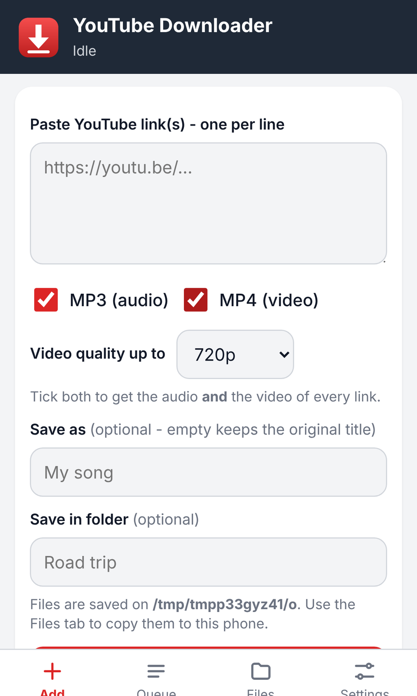
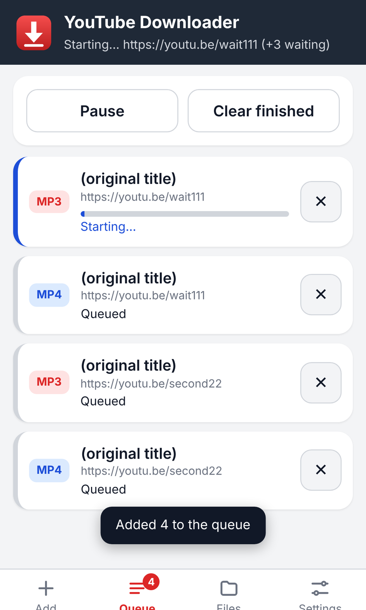
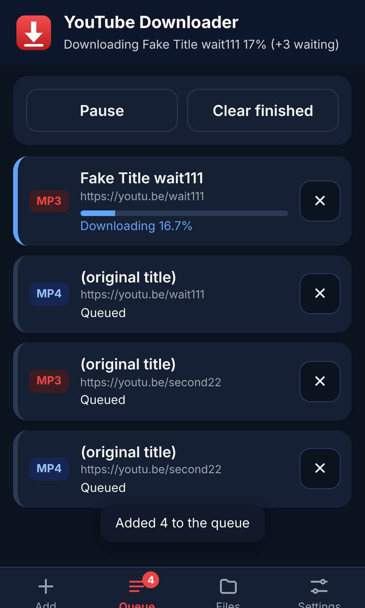

# YouTube Downloader - Windows, Android and iPhone

Paste YouTube links, choose **MP3 (audio)** and/or **MP4 (video)**, and let an ordered queue download them one by one.
Optional limits ("max 3 downloads per 1 hour + 30 minutes"), timed pauses, your own file names and folders, and it keeps
working in the background.

| You have | Download | Guide |
|---|---|---|
| **Windows PC** | [YouTubeDownloader-Setup.exe](https://github.com/HDumo/YoutubeDownloader/raw/main/dist/YouTubeDownloader-Setup.exe) | [docs/WINDOWS.md](docs/WINDOWS.md) |
| **Android phone** | [YouTubeDownloader.apk](https://github.com/HDumo/YoutubeDownloader/raw/main/dist/YouTubeDownloader.apk) | [docs/ANDROID.md](docs/ANDROID.md) |
| **iPhone / iPad** | nothing to install - use Safari (no App Store app exists) | [docs/IOS.md](docs/IOS.md) |
| Mac / Linux / Raspberry Pi / NAS (as the server) | [YouTubeDownloader-PhoneServer.zip](https://github.com/HDumo/YoutubeDownloader/raw/main/dist/YouTubeDownloader-PhoneServer.zip) | [docs/ANDROID.md](docs/ANDROID.md#option-c---any-other-computer-as-the-server) |

## How the pieces fit

```
 Windows desktop app  ---------------------------- downloads on the PC (queue, MP3/MP4, limits, pauses, tray icon)

 Phone edition  = small server + mobile web app (same features, big touch buttons, dark mode)
      server runs on:  your Windows PC  |  the Android phone itself (Termux)  |  Mac / Linux / Raspberry Pi
      used from:       Android app (APK) | Chrome | iPhone Safari / "Add to Home Screen" | any browser
```

* The desktop app needs **no Python and no admin rights**; it downloads `yt-dlp` and `ffmpeg` on first start.
* The phone edition is protected by a **PIN** shown when the server starts, and only works on your own network.
* **iPhone/iPad cannot run the downloader themselves** (iOS does not allow it); they use a server running on a PC or an
  Android phone and save the finished files to the Files app.

## What it does

* Queue in the order you add links; one download at a time.
* **MP3 and/or MP4** per link (tick both for audio *and* video). MP4 quality cap: Best, 1080p, 720p, 480p, 360p.
* **Save as** - keep the original title or type your own name; choose the folder.
* **Limit**: *max N downloads per A [unit] + B [smaller unit]* (e.g. 3 per 1 Hours + 30 Minutes). Extra links wait and start by themselves.
* **Pause** now, *resume in* A [unit] + B [smaller unit], or *pause until* a date and time.
* Remove / cancel / retry any item; the queue survives closing the app.
* Windows: closing the window keeps it running in the system tray.

Only download audio and video you have the right to (your own uploads, Creative Commons, or with the owner's permission);
downloading can break YouTube's Terms of Service.

## Screenshots (mobile web app)

  

## For developers

| Path | What |
|---|---|
| `YouTubeMP3.ps1` | Windows desktop app (PowerShell + WinForms) |
| `PhoneServer.ps1`, `Start Phone Server.bat` | Windows launcher for the phone server (fetches a private Python) |
| `mobile/server/ytdl_server.py`, `mobile/server/web/` | Phone server (Python standard library only) + mobile web app |
| `mobile/android/` | Android app source, `build-apk.sh`, `termux-setup.sh` |
| `installer/` | NSIS installer script and artwork generator |
| `tests/`, `mobile/tests/` | All automated tests - run `sh tests/run-all.sh` (see [docs/TESTING.md](docs/TESTING.md)) |
| `build-release.sh` | Rebuilds everything in `dist/` |
